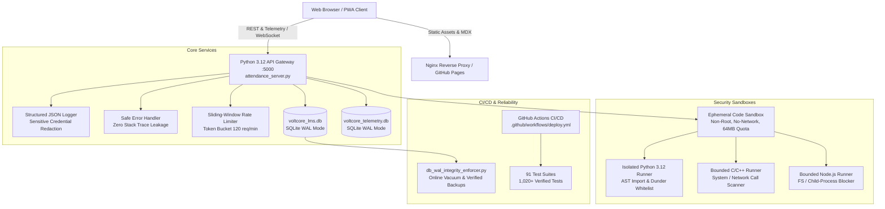

# VoltCore Apex Academia — Enterprise Deployment, Sandbox Security & Backup Guide

**Platform Lead & Systems Architect:** Ashok Kumar A (2023MITEC042)  
**Institution:** Madras Institute of Technology (MIT) Campus, Anna University, Chromepet  
**Department:** Electronics Engineering (Embedded Systems & Academic Computing)  
**Curriculum Regulation:** Regulation 2023 (Outcome-Based Education & NBA Tier-1 Standard)  
**Target Environment:** Docker Multi-Stage Container / Linux Alpine & Debian Slim / Local Windows HP Victus (`LAPTOP-3NEGBVLE`)  

---

## 1. Production Architecture Overview

VoltCore Apex Academia employs a high-performance, decoupled micro-architecture engineered for low thermal footprint, deterministic hardware-safe operations, and zero data loss:



---

## 2. Stage 6 — Student Code Execution Sandbox Architecture

### 2.1 Threat Model & Security Invariants
Student code submissions in technical subjects (Embedded Systems, Verilog, DSP, Algorithms) represent untrusted input that must execute in complete isolation:

1. **Non-Root Execution**:
   - In production Docker containers, code runs strictly as an unprivileged user (`UID 1000:1000` / `USER voltcore`). Root access and Linux capabilities (`CAP_DROP ALL`) are removed.
2. **Network Isolation**:
   - Outbound and inbound network access is disabled (`--network none`).
   - Host proxies and socket APIs are neutralized (`NO_PROXY=*`, proxy environment variables stripped).
3. **Strict Resource Quotas**:
   - **Execution Timeout**: Default 2.0 seconds; hard upper bound of 5.0 seconds.
   - **Memory Quota**: Bounded to 64MB (swap disabled).
   - **Process Limit**: Maximum 32 PIDs (prevents fork bombs).
   - **Output Buffer Quota**: Truncated at 64 KB (prevents memory exhaustion from runaway loops).
4. **Ephemeral Filesystem Lifecycle**:
   - Dedicated temporary directory created via `tempfile.mkdtemp(prefix="voltcore_sandbox_")`.
   - Guaranteed automatic deletion via `shutil.rmtree(temp_dir, ignore_errors=True)` in a `finally` block.

### 2.2 Static AST Pre-Execution Whitelisting
Before any code reaches a runtime or compiler, [`backend/sandbox_code_executor.py`](file:///c:/Users/Ashok%20kumar%20A/OneDrive/Documents/VoltCore-LMS-Portal/backend/sandbox_code_executor.py) performs AST-level token analysis:

- **Python (`ast.walk`)**:
  - Prohibits dangerous imports: `os`, `sys`, `subprocess`, `socket`, `shutil`, `urllib`, `requests`, `ctypes`, `threading`, `importlib`.
  - Prohibits forbidden builtins: `eval()`, `exec()`, `compile()`, `open()`, `input()`, `__import__()`, `getattr()`.
  - Blocks dunder attribute traversal (`__class__`, `__subclasses__`).
- **C and C++**:
  - Regex pre-scanner blocks network headers: `<sys/socket.h>`, `<netinet/in.h>`, `<winsock2.h>`.
  - Blocks process and shell execution primitives: `system()`, `fork()`, `popen()`, `execve()`, `CreateProcess()`.
- **JavaScript (Node.js)**:
  - Scans and rejects `child_process`, `fs`, `net`, `http`, `dgram`, `eval()`, `Function()`, `process.exit()`.

### 2.3 Docker Production Sandbox Specification
For production Kubernetes / Docker deployments, invoke via ephemeral containers:
```bash
docker run --rm \
  --network none \
  --memory 64m \
  --memory-swap 64m \
  --cpus 0.5 \
  --pids-limit 32 \
  --read-only \
  --user 1000:1000 \
  --cap-drop ALL \
  --security-opt no-new-privileges \
  -v /tmp/voltcore_sandbox_xyz:/sandbox:rw \
  voltcore/sandbox-runner:2026 python3 /sandbox/solution.py
```

---

## 3. Stage 7 — Production Readiness, Observability & Error Handling

### 3.1 Structured JSON Logging
Implemented in [`backend/structured_logger.py`](file:///c:/Users/Ashok%20kumar%20A/OneDrive/Documents/VoltCore-LMS-Portal/backend/structured_logger.py):
- Every log message emits valid RFC 3339 JSON:
```json
{
  "timestamp": "2026-11-07T13:30:00.000000Z",
  "service": "voltcore_apex_api",
  "level": "INFO",
  "message": "Student code execution completed",
  "correlation_id": "req_84f9b201a0cd",
  "client_id": "2023MITEC042",
  "duration_ms": 14.85,
  "context": {
    "language": "python",
    "exit_code": 0,
    "token": "[REDACTED_CREDENTIAL]"
  }
}
```
- **Automated Sensitive Field Redaction**: Recursively strips `password`, `secret`, `token`, `jwt`, `key`, `api_key`, `authorization`, and `cookie`.

### 3.2 Safe Error Response Protocol
Clients never receive Python tracebacks, SQLite file paths, or internal schema structures:
```json
{
  "status": "ERROR",
  "error_code": "INTERNAL_SERVER_ERROR",
  "message": "An internal error occurred while processing the request.",
  "correlation_id": "inc_e4c92a10bd71",
  "timestamp": "2026-11-07T13:30:00.000000Z"
}
```
The internal diagnostic exception is logged exclusively to backend server logs tagged with the matching `correlation_id` (`inc_...`).

### 3.3 Production Healthcheck & Audit Endpoints
- `GET /api/system/health`: Reports live SQLite WAL page integrity, thread pool utilization, and thermal guard profile.
- `GET /api/production/readiness`: Executes comprehensive multi-point audit:
  - Validates `voltcore_lms.db` and `voltcore_telemetry.db` WAL mode and 0 FK violations.
  - Verifies zero private admin email, phone, or cloud key leakage.
  - Checks Dockerfile multi-stage configuration and PWA offline route caching.

---

## 4. SQLite Database WAL Mode & Disaster Recovery Runbook

### 4.1 SQLite WAL Concurrency Rules
All SQLite database connections must enforce the following pragmas:
```sql
PRAGMA journal_mode = WAL;
PRAGMA synchronous = NORMAL;
PRAGMA busy_timeout = 5000;
PRAGMA foreign_keys = ON;
```

### 4.2 Automated Online Backup Execution
To perform an online zero-downtime backup without interrupting active student lab sessions:
```bash
python scripts/db_wal_integrity_enforcer.py
```
This utility:
1. Opens `voltcore_lms.db` and `voltcore_telemetry.db` in read-only lock.
2. Invokes SQLite native online backup API (`conn.backup(target_conn)`).
3. Verifies `PRAGMA integrity_check` on the generated backup file.
4. Generates a timestamped verified snapshot in `backend/cache/backups/`.

### 4.3 Database Restoration Procedure
In the event of hardware corruption or accidental table drop:
1. Stop the application server:
   ```bash
   pkill -f attendance_server.py
   ```
2. Locate the latest verified backup in `backend/cache/backups/`:
   ```bash
   ls -lt backend/cache/backups/
   ```
3. Restore the verified snapshot:
   ```bash
   cp backend/cache/backups/voltcore_lms_backup_YYYYMMDD_HHMMSS.db voltcore_lms.db
   cp backend/cache/backups/voltcore_telemetry_backup_YYYYMMDD_HHMMSS.db voltcore_telemetry.db
   ```
4. Verify database integrity before restarting:
   ```bash
   sqlite3 voltcore_lms.db "PRAGMA integrity_check;"
   sqlite3 voltcore_telemetry.db "PRAGMA integrity_check;"
   ```
5. Restart the server:
   ```bash
   python attendance_server.py
   ```

---

## 5. Privacy, Attainment & Security Invariants

1. **Zero Credential Leakage**:
   - Private email (`ashokkumar2008313@gmail.com`) and telephone (`9597382878`) are strictly prohibited in code, commits, or client files.
   - Public author attribution is standardized:
     - Name: `Ashok Kumar A`
     - Register No: `2023MITEC042`
     - Public Contact: `ashokkumar3132008@gmail.com`
     - GitHub: `https://github.com/AshokKumar313`
     - Institutional Domain: `Madras Institute of Technology (MIT) Campus, Anna University`
2. **Thermal & Resource Protocol (HP Victus 15 LAPTOP-3NEGBVLE)**:
   - Target idle CPU load: `<5%`.
   - Single-process test execution (`python -m pytest tests/`).
   - Zero background polling loops.
