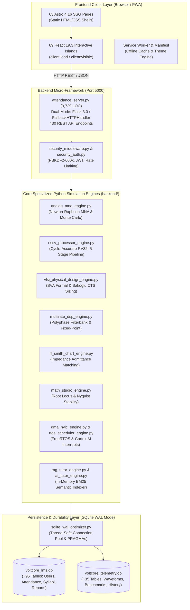

# VoltCore Apex Academia — Complete LMS Current Status Audit
# 02. Project Architecture Map

**Audit Date**: November 7, 2026  
**Auditor**: Principal Software Architect & DevOps Auditor  
**Audit Location**: `docs/audits/02_PROJECT_ARCHITECTURE_MAP.md`

---

## 1. High-Level Architectural Overview

VoltCore Apex Academia utilizes a decoupled, high-performance hybrid architecture designed to operate with minimal resource consumption on Windows workstations while maintaining industrial-grade engineering rigor.

---

## 2. Directory Structure & Responsibilities

| Directory | Responsibilities & Contents | File Count / Size |
| :--- | :--- | :--- |
| `src/pages/` | Astro routes governing all views (Dashboards, Academics, Labs, Simulators). | 63 `.astro` pages |
| `src/components/` | React 19 interactive islands powering dynamic visualizers, canvases, and controls. | 89 `.jsx` components |
| `src/content/` | Content collections: `stm32-academy` (21 chapters), `modules` (10 tracks), `components`, `simulations`. | 35+ Markdown / MDX files |
| `src/data/` | Static data schemas (`course_config_schema.ts`, `course_lessons_data.ts`, `course_lab_data.ts`). | 6 TypeScript / JSON files |
| `backend/` | Specialized engineering engines (MNA, DSP, VLSI, RISC-V, RF, FreeRTOS, SVA, RAG). | 80+ Python modules (2.4 MB) |
| `deploy/` | Container deployment, healthcheck scripts, and production readiness audit suites. | 5 deployment utilities |
| `public/` | Static web assets: favicon, manifests, PWA icons, offline assets. | Web standard assets |
| `tests/` | Pytest suites covering unit, integration, simulation, REST, and E2E verification. | 89 test files (977 tests) |
| `scratch/` | Temporary operational scratchpad scripts (transient, non-production). | Cleaned after each phase |

---

## 3. Frontend Architecture

- **Static-Site Generation (SSG) with Astro 4.16.18**:
  - The platform renders static HTML shells for maximum performance and zero server rendering overhead.
  - Page routes live directly in `src/pages/` and compile to `dist/` during production builds.
- **Dynamic React 19.3.1 Islands**:
  - Complex UI controls and interactive canvases are embedded as client-side React islands using Astro's directive system (`client:load`, `client:visible`, `client:idle`).
  - Components include the `VirtualOscilloscope.jsx`, `MnaAnalogWorkbench.jsx`, `MathStudioHub.jsx`, and `Stm32AcademyHub.jsx`.
- **Styling & Design Tokens**:
  - Tailwind CSS 3.4.17 with typography plugins.
  - Custom glassmorphic styling tokens (`glass-card`, `glass-card-accent`, `shadow-emerald-glow`) defined in `src/styles/global.css`.
  - Immediate zero-latency theme initializer in `MainLayout.astro` supporting 18 distinct educational theme palettes.
- **Mathematics & Typography**:
  - KaTeX math rendering support embedded in markdown and formula cards (`KatexFormulaCard.jsx`).
  - Google Fonts integration for Inter, JetBrains Mono, and STIX Two Text for academic paper formatting.

---

## 4. Backend Architecture

- **Server Core (`attendance_server.py`)**:
  - Monolithic server architecture spanning 9,739 lines of code.
  - Dual-mode execution:
    1. **Primary**: Flask 3.0+ with `flask-cors` for cross-origin local requests.
    2. **Fallback**: Built-in Python standard library `FallbackHTTPHandler` (`BaseHTTPRequestHandler`) ensuring zero-dependency execution when external wheels are unavailable.
- **Route Distribution**:
  - 430 REST routes mapped across GET, POST, and OPTIONS methods.
  - JSON payloads for all command and query interactions.
- **Security Middleware (`backend/security_middleware.py`)**:
  - Injects mandatory OWASP / IEEE security headers (`X-Content-Type-Options: nosniff`, `X-Frame-Options: SAMEORIGIN`, `Content-Security-Policy`).
  - Enforces in-memory token bucket rate limiting (120 requests/minute per client).

---

## 5. Database Architecture

- **SQLite 3 with Write-Ahead Logging (WAL)**:
  - The platform operates on two distinct SQLite databases:
    1. **`voltcore_lms.db`** (1.2 MB): Manages LMS entities including `users`, `attendance`, `academic_syllabus_subjects`, `module_lifecycle`, `student_portfolios`, and `course_lab_observations` (~95 tables).
    2. **`voltcore_telemetry.db`** (500 KB): Stores dense time-series telemetry including `vlsi_physical_design_history`, `riscv_processor_history`, `fpga_synthesis_runs`, and `tinyml_benchmarks` (~35 tables).
- **WAL Concurrency Optimizations (`backend/sqlite_wal_optimizer.py`)**:
  - `PRAGMA journal_mode = WAL;` (Enables concurrent readers while writing).
  - `PRAGMA synchronous = NORMAL;` (Eliminates excessive `fsync()` operations).
  - `PRAGMA busy_timeout = 5000;` (Prevents immediate lock exceptions under burst load).
  - `PRAGMA mmap_size = 268435456;` (256 MB memory-mapped I/O).

---

## 6. Authentication & Role-Based Access Control (RBAC)

- **Cryptographic Password Security (`lms_database.py`)**:
  - PBKDF2-HMAC-SHA256 upgraded to **600,000 iterations** (exceeding OWASP 2024 recommendations).
  - Cryptographically secure 16-byte random salts via `secrets.token_bytes()`.
  - Constant-time password verification via `hmac.compare_digest()`.
- **Token Infrastructure (`backend/security_auth.py`)**:
  - Standard HMAC-SHA256 signed JSON Web Tokens (JWT).
  - Four discrete RBAC roles: `Student`, `Teacher`, `Lab-Instructor`, `Admin`.
- **Current Limitation**:
  - The backend token engine is decoupled from the frontend navigation; Astro pages currently lack client-side redirect guards.

---

## 7. Embedded Systems & Simulation Pipeline

- **Client-Side Simulation**:
  - Interactive Wokwi Web Simulator integration via `WokwiSimulationController.jsx` and `WokwiSandbox.astro` for microcontroller emulation (ESP32, Arduino Uno, Raspberry Pi Pico).
- **Backend Numerical Simulation**:
  - Non-linear Modified Nodal Analysis circuit solver ([`backend/analog_mna_engine.py`](file:///c:/Users/Ashok%20kumar%20A/OneDrive/Documents/VoltCore-LMS-Portal/backend/analog_mna_engine.py)).
  - Cycle-accurate RV32I 5-stage pipelined processor ([`backend/riscv_processor_engine.py`](file:///c:/Users/Ashok%20kumar%20A/OneDrive/Documents/VoltCore-LMS-Portal/backend/riscv_processor_engine.py)).
  - SystemVerilog assertion verification engine ([`backend/vlsi_physical_design_engine.py`](file:///c:/Users/Ashok%20kumar%20A/OneDrive/Documents/VoltCore-LMS-Portal/backend/vlsi_physical_design_engine.py)).
  - Multirate DSP polyphase filterbank & fixed-point quantizer ([`backend/multirate_dsp_engine.py`](file:///c:/Users/Ashok%20kumar%20A/OneDrive/Documents/VoltCore-LMS-Portal/backend/multirate_dsp_engine.py)).
  - RF Smith chart complex reflection & admittance matching ([`backend/rf_smith_chart_engine.py`](file:///c:/Users/Ashok%20kumar%20A/OneDrive/Documents/VoltCore-LMS-Portal/backend/rf_smith_chart_engine.py)).
