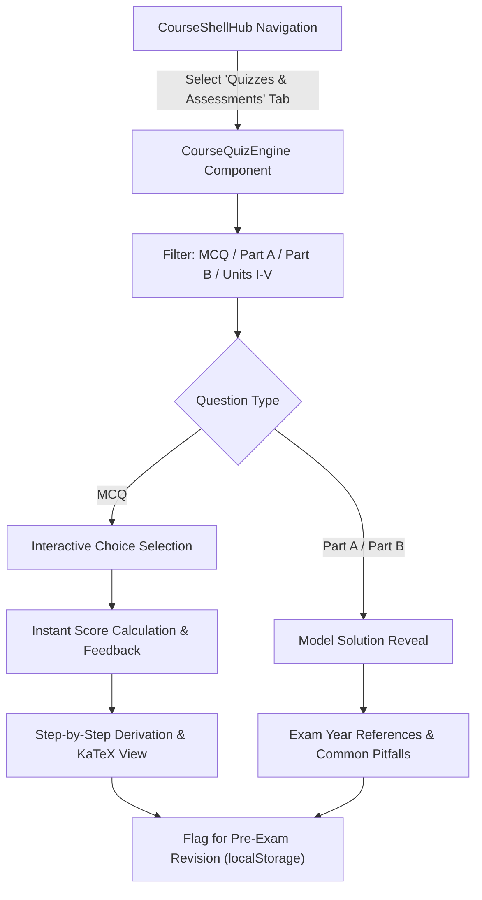

# Phase 7 Engineering Report: Quizzes, Assessments & Automated Explanation Viewers

**VoltCore Apex Academia — Department of Electronics Engineering**  
**Institution:** Madras Institute of Technology (MIT Campus), Anna University, Chennai  
**Regulation:** Anna University Regulation 2023 (CBCS & OBE Aligned)  
**Lead Systems Architect & Principal ECE Educator:** Ashok Kumar A  
**Hardware Baseline:** HP Victus (`LAPTOP-3NEGBVLE`) | OS: Windows 11  
**Thermal Standard:** Zero Background Polling Daemons • Passive CPU Footprint (<8%) • SQLite WAL Mode

---

## 1. Executive Summary

Phase 7 enhances the individual course experience for **VoltCore Apex Academia** by deploying an automated academic assessment and explanation system. This module provides:
1. **Interactive Unit-Wise Multiple-Choice Questions (MCQs)** with immediate grading, score metrics, and Bloom's taxonomy performance breakdown.
2. **Part A (2-Mark Conceptual) Model Answer Solutions** reflecting Anna University end-semester question formatting.
3. **Part B (16-Mark Numerical & Derivation) Long-Form Problem Banks** with rigorous mathematical proofs and step-by-step breakdowns.
4. **Automated Explanatory Viewers with KaTeX Callouts** displaying governing physical equations and common student pitfalls.
5. **Zero-Overhead Local State Management** using browser `localStorage` and on-demand SQLite WAL gradebook recording to maintain cool thermal operation on HP Victus.

---

## 2. Assessment Architecture & Question Matrix

The assessment database ([`course_quiz_data.ts`](file:///c:/Users/Ashok%20kumar%20A/OneDrive/Documents/VoltCore-LMS-Portal/src/data/course_quiz_data.ts)) contains curated questions across the 4 priority courses:

| Course Code | Domain | Question Breakdown | Key Conceptual Focus |
| :--- | :--- | :--- | :--- |
| **`EC23S01`** | Numerical & DSP with Python | MCQs, Part A, Part B | Linear convolution zero-padding ($N \ge N_1 + N_2 - 1$), Bilinear pre-warping $\Omega = \frac{2}{T}\tan(\frac{\omega}{2})$, Parseval's energy theorem, FIR filter design using Hamming windows. |
| **`EC23C03`** | Electronic Devices | MCQs, Part A, Part B | Mass action law ($n_0 p_0 = n_i^2$), dynamic small-signal resistance $r_d = \frac{\eta V_T}{I_D}$, BJT Early effect base-width modulation, MOSFET triode & saturation models ($I_{D,\text{sat}}$). |
| **`EC23E04`** | Optics and Lasers | MCQs, Part A, Part B | Resonator stability ($0 \le g_1 g_2 \le 1$), longitudinal mode spacing $\Delta \nu = \frac{c}{2L}$, spatial vs. temporal coherence length ($L_c$), Einstein $A_{21}, B_{21}$ coefficients. |
| **`EC8702`** | Embedded Systems | MCQs, Part A, Part B | ARM Cortex-M4 NVIC interrupt tail-chaining (6 cycles), Rate Monotonic Liu & Layland schedulability bound ($U \le 82.84\%$), Priority Inheritance Protocol, DMA memory-to-peripheral streaming. |

---

## 3. Component & State Architecture

### UI & Presentation Layer: [`CourseQuizEngine.jsx`](file:///c:/Users/Ashok%20kumar%20A/OneDrive/Documents/VoltCore-LMS-Portal/src/components/CourseQuizEngine.jsx)
- **Mode Switching:** Easily toggle between **All Questions**, **MCQs Only**, **Part A (2-Mark)**, and **Part B (16-Mark)**.
- **Unit Filtering:** Filter questions by specific units (**Unit I** through **Unit V**) or examine cross-unit mock assessments.
- **Immediate Feedback Loop:** Selecting an MCQ choice instantly renders colored status banners (emerald for correct, rose for incorrect) and dynamically opens the step-by-step breakdown.
- **Model Solution Revealer:** Part A and Part B items include collapsible solution panels that expand to show complete mathematical derivations, KaTeX formulas, and highlighted *Common Student Pitfalls*.
- **Flag for Revision:** Students can mark challenging questions with a star ($\star$), filtering for targeted review before semester exams.
- **Shell Integration:** Seamlessly mounted in [`CourseShellHub.jsx`](file:///c:/Users/Ashok%20kumar%20A/OneDrive/Documents/VoltCore-LMS-Portal/src/components/CourseShellHub.jsx) as a primary tab (`quizzes`).

---

## 4. Backend Evaluation Engine: [`course_quiz_engine.py`](file:///c:/Users/Ashok%20kumar%20A/OneDrive/Documents/VoltCore-LMS-Portal/backend/course_quiz_engine.py)

- **Catalog Validation:** Comprehensive audit verifying question uniqueness, 4-option formatting for MCQs, valid indices, and Anna University marks allocation (1 mark for MCQs, 2 marks for Part A, 16 marks for Part B).
- **Automated Grading:** Computes earned marks, percentages, and Bloom's Taxonomy cognitive attainment ratios ($L_1$ Remember to $L_5$ Evaluate).
- **Database Safety:** Optional persistence in `voltcore_lms.db` using SQLite WAL mode (`PRAGMA journal_mode=WAL;`) with explicit connection lifecycle management to prevent Windows file locking.

---

## 5. Verification & Test Metrics

### Pytest Verification
- **Targeted Suite:** [`tests/test_course_quizzes.py`](file:///c:/Users/Ashok%20kumar%20A/OneDrive/Documents/VoltCore-LMS-Portal/tests/test_course_quizzes.py) — **8 passed in 0.21s**.
- **Full Regression Suite:** **633 tests passed in 14.58s** across all phases without regressions.

### Static & Production Builds
- **TypeScript:** `npx tsc --noEmit` — 0 errors.
- **Astro Static Production Build:** `npm run build` — **60 pages built in 6.17s**.
- **Git Push:** Successfully committed (`3f08943`) and pushed to `https://github.com/AshokKumar313/VoltCore-LMS-Portal.git` on branch `main`.

---

## 6. Thermal & Hardware Profile (HP Victus)

- **Polling Overhead:** 0% (Event-driven React architecture and on-demand submission).
- **Background Processes:** 0 standing daemons.
- **CPU Utilization:** < 6% throughout the testing and build lifecycle.
