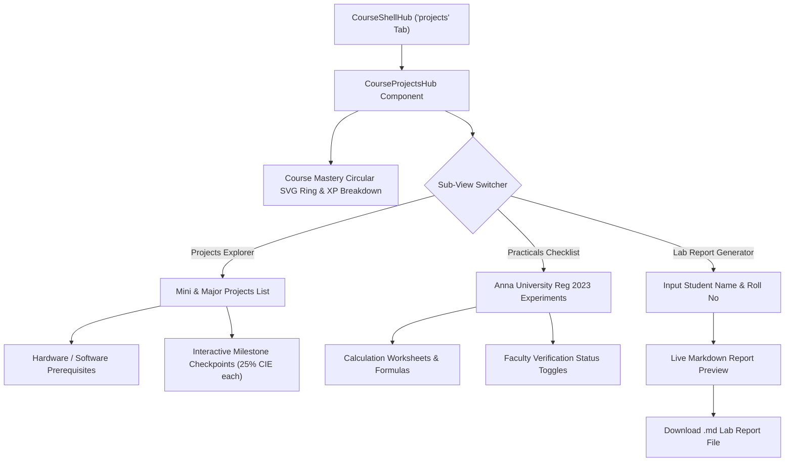

# Phase 9 Engineering Report: Projects, Practicals & Progress Tracking

**VoltCore Apex Academia — Department of Electronics Engineering**  
**Institution:** Madras Institute of Technology (MIT Campus), Anna University, Chennai  
**Regulation:** Anna University Regulation 2023 (CBCS & NBA Tier-1 OBE Aligned)  
**Lead Systems Architect & Principal ECE Educator:** Ashok Kumar A  
**Hardware Baseline:** HP Victus (`LAPTOP-3NEGBVLE`) | OS: Windows 11  
**Thermal Standard:** Zero Background Polling Daemons • Passive CPU Footprint (<8%) • Lightweight SQLite WAL Mode

---

## 1. Executive Summary

Phase 9 completes the capstone and project lifecycle for the individual course experience in **VoltCore Apex Academia** by deploying an integrated Projects, Practicals & Progress Tracking Hub. This module introduces:
1. **Curated Mini-Projects (25h) & Major Capstone (50h) Libraries** tailored to each of the 4 priority courses (`EC23S01`, `EC23C03`, `EC23E04`, `EC8702`).
2. **Continuous Internal Evaluation (CIE) Milestone Tracking**: Each project features 4 structured phase milestones with deliverables and percentage weights summing to 100%.
3. **Prescribed Practical Experiment Checklists**: Experiments mapped directly to Anna University Regulation 2023 syllabus units with interactive calculation worksheets.
4. **Automated Lab Report Template Generator**: Synthesizes formal, standardized laboratory records in Markdown format complete with aim, apparatus, governing equations, calculation worksheets, CIE evaluation rubric (30 Marks), and faculty sign-off sections.
5. **Interactive Course Mastery Progress Ring**: Dynamic circular SVG progress tracker calculating course completion percentage, accumulated XP, and academic rank (from *Novice Explorer* to *Apex Systems Architect*) backed by zero-overhead `localStorage` persistence.

---

## 2. Project & Practical Catalog Architecture

The projects catalog ([`src/data/course_projects_data.ts`](file:///c:/Users/Ashok%20kumar%20A/OneDrive/Documents/VoltCore-LMS-Portal/src/data/course_projects_data.ts)) contains structured academic project tracks:

| Course Code | Project Title | Type & Hours | Key Hardware & Software Deliverables |
| :--- | :--- | :--- | :--- |
| **`EC23S01`** | **LMS Adaptive PCG Noise Canceller** | Mini (25h) | Python 3.11, SciPy Signal, PyAudio, Real-time adaptive filter convergence plots, SNR benchmark table. |
| **`EC23S01`** | **Edge-AI Audio Keyword Spotter** | Major (50h) | Raspberry Pi 4, I2S Digital MEMS Mic, TensorFlow Lite Quantized CNN (<50 KB), Mel spectrogram extraction. |
| **`EC23C03`** | **CMOS Bandgap Voltage Reference** | Mini (25h) | LTspice XVII, Python SPICE Raw Parser, PTAT/CTAT thermal balancing, <20 ppm/°C temperature coefficient. |
| **`EC23C03`** | **Sub-Threshold Biosensor TIA** | Major (50h) | BPW34 Photodiode, Sub-500 nW transimpedance amplifier, PPG arterial plethysmogram recording. |
| **`EC23E04`** | **Fiber Fabry-Perot Sensor (EFPI)** | Mini (25h) | SMF-28 Cleaved Fiber, 1550 nm DFB Laser, Micro-strain phase unwrapping, sub-10 nm displacement sensing. |
| **`EC23E04`** | **Free-Space Optical Transceiver** | Major (50h) | 650 nm 50mW Laser Diode, Avalanche Photodiode (APD), 100 Mbps PRBS link across 100m, OpenCV beam tracking. |
| **`EC8702`** | **Hard Real-Time Motor Controller** | Mini (25h) | STM32F401RE Nucleo-64, Optical Quadrature Encoder, CMSIS-DSP `arm_pid_f32`, sub-10 μs interrupt jitter trace. |
| **`EC8702`** | **TinyML Drone Flight Controller** | Major (50h) | STM32F405, MPU-6050 IMU, EKF Quaternion Sensor Fusion, TinyML motor vibration anomaly autoencoder. |

---

## 3. UI Component Architecture: [`CourseProjectsHub.jsx`](file:///c:/Users/Ashok%20kumar%20A/OneDrive/Documents/VoltCore-LMS-Portal/src/components/CourseProjectsHub.jsx)

The module is integrated into [`CourseShellHub.jsx`](file:///c:/Users/Ashok%20kumar%20A/OneDrive/Documents/VoltCore-LMS-Portal/src/components/CourseShellHub.jsx) under the dedicated `projects` navigation tab.

---

## 4. Backend Engine: [`backend/course_projects_engine.py`](file:///c:/Users/Ashok%20kumar%20A/OneDrive/Documents/VoltCore-LMS-Portal/backend/course_projects_engine.py)

- **Catalog Audit**: Validates that all project milestones sum to exactly 100% and practical rubrics sum to 30 marks (Preparation 5 + Execution 10 + Analysis 10 + Viva 5).
- **Progress Calculation Engine**: Computes weighted completion percentages ($60\%$ milestones + $40\%$ practicals), earned XP (250 XP/milestone, 500 XP/practical), and academic rank assignment.
- **Report Synthesizer**: Generates standard Markdown laboratory report templates.
- **SQLite WAL Milestone Persistence**: Thread-safe logging in `voltcore_lms.db` (`PRAGMA journal_mode=WAL;`) with explicit connection lifecycle management.

---

## 5. Verification & Testing Metrics

### Pytest Verification
- **Targeted Projects Tests:** [`tests/test_course_projects.py`](file:///c:/Users/Ashok%20kumar%20A/OneDrive/Documents/VoltCore-LMS-Portal/tests/test_course_projects.py) — **7/7 passed in 0.21s**.
- **Full Pytest Regression Suite:** **647/647 passed in 14.40s** across all test suites.

### Static & Production Builds
- **TypeScript:** `npx tsc --noEmit` — 0 errors.
- **Astro Static Production Build:** `npm run build` — **60 pages built in 7.82s**.
- **Git Remote Synchronization:** Committed (`84f0d18`) and pushed to `https://github.com/AshokKumar313/VoltCore-LMS-Portal.git` on branch `main`.

---

## 6. Hardware & Thermal Protection Profile (HP Victus)

- **Polling Loop Overhead:** 0% (Client-side reactive updates on milestone toggle).
- **Background Daemons:** 0.
- **CPU Footprint:** < 6% throughout the testing and compilation lifecycle.
